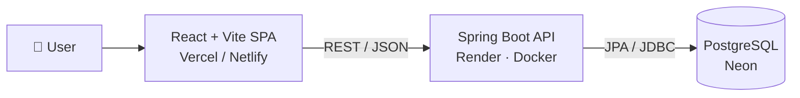

<div align="center">


# MedRem

**Your medications, organised and on time.**

A full-stack medication reminder and health dashboard: reminders, prescriptions, drug info, nearby pharmacies and safety alerts in one place.

[](https://react.dev)
[](https://vite.dev)
[](https://tailwindcss.com)
[](https://spring.io/projects/spring-boot)
[](https://neon.tech)
[](backend/Dockerfile)

[Live Demo](#-live-demo) · [Features](#-features) · [Quick Start](#-quick-start) · [API](#-api-overview) · [Deployment](#-deployment)

</div>

---

## 📸 Preview

<!-- Replace with real screenshots: save them in docs/ and update the paths below -->
| Login | Dashboard |
|:---:|:---:|
|  |  |

## 🌐 Live Demo

> **Coming soon.** Follow the [deployment steps](#-deployment) and paste your Vercel link here.

## ✨ Features

| | Feature | What it does |
|---|---|---|
| 🔐 | **Secure accounts** | Sign up / sign in, BCrypt-hashed passwords, optional "keep me signed in" |
| 📊 | **Dashboard** | Overview of today's doses, saved drugs and recent activity |
| ⏰ | **Reminders** | Add medicines with dosage and time, then pause, resume or delete them |
| 📄 | **Prescriptions** | Drag-and-drop prescription uploads and a list of saved files |
| 💊 | **Drug details** | Search by brand or generic name for dosage, side effects and interactions |
| 📷 | **Drug scanner** | Scanning interface for identifying medicines (UI prototype) |
| 📍 | **Pharmacies** | Search nearby pharmacies with hours, rating and contact info |
| ⚠️ | **Safety alerts** | Severity-filtered alerts for missed doses and risky combinations |
| 👤 | **Profile** | Personal and doctor details in one place |

**UX touches:** fully responsive (mobile → desktop), collapsible sidebar, light/dark theme, keyboard-accessible navigation, loading states and lazy-loaded pages.

## 🛠 Tech Stack

| Layer | Technologies |
|---|---|
| **Frontend** | React 19 · Vite 7 · Tailwind CSS · shadcn/ui (Radix) · Framer Motion · React Hook Form + Zod · React Router 7 |
| **Backend** | Java 17+ · Spring Boot 4 · Spring Security · Spring Data JPA · Lombok |
| **Database** | PostgreSQL (hosted on Neon) |
| **DevOps** | Docker · Render (API) · Vercel / Netlify (web) |

## 🏗 Architecture



The backend follows a classic layered design: **Controller → Service → Repository → Entity**. More detail is in [docs/architecture.md](docs/architecture.md) and [docs/database.md](docs/database.md).

## 📁 Project Structure

```
reminder/
├── frontend/                 React app
│   ├── public/               favicon, images, Netlify _redirects
│   ├── src/
│   │   ├── components/
│   │   │   ├── auth/         shared login/signup layout
│   │   │   ├── layout/       app shell: Navbar, Sidebar
│   │   │   └── ui/           shadcn primitives (button, input, card…)
│   │   ├── lib/              api.ts (fetch wrapper), auth.ts (session)
│   │   └── pages/            one component per route
│   └── vercel.json           SPA rewrites
├── backend/                  Spring Boot API
│   ├── src/main/java/com/example/backend/
│   │   ├── config/           security, CORS, password hashing
│   │   ├── controller/       REST endpoints
│   │   ├── service/          business logic
│   │   ├── repository/       Spring Data JPA
│   │   └── entity/           JPA entities
│   └── Dockerfile
├── docs/                     API, architecture and database notes
└── render.yaml               Render blueprint
```

## 🚀 Quick Start

### Prerequisites

- [Node.js](https://nodejs.org) 20+
- [Java](https://adoptium.net) 17+ (the Maven wrapper is included)
- A PostgreSQL database (a free [Neon](https://neon.tech) project works)

### 1. Clone

```bash
git clone https://github.com/shiva-1301/reminder.git
cd reminder
```

### 2. Run the backend

```bash
cd backend
cp .env.example .env          # fill in DB_URL, DB_USERNAME, DB_PASSWORD
./mvnw spring-boot:run        # Windows: mvnw.cmd spring-boot:run
```

The API starts on **http://localhost:8080**. Tables are created automatically on first run.

### 3. Run the frontend

```bash
cd frontend
cp .env.example .env.local    # VITE_API_BASE_URL=http://localhost:8080
npm install
npm run dev
```

Open **http://localhost:5173**, create an account and sign in.

### Available scripts (frontend)

| Command | Description |
|---|---|
| `npm run dev` | Start the dev server with hot reload |
| `npm run build` | Production build to `dist/` |
| `npm run preview` | Serve the production build locally |
| `npm run lint` | Run ESLint |

## 🔑 Environment Variables

<details>
<summary><b>Backend</b> (<code>backend/.env</code>)</summary>

| Variable | Required | Description |
|---|:---:|---|
| `DB_URL` | ✅ | JDBC URL, e.g. `jdbc:postgresql://host/db?sslmode=require` |
| `DB_USERNAME` | ✅ | Database user |
| `DB_PASSWORD` | ✅ | Database password |
| `ALLOWED_ORIGINS` | | Comma-separated frontend URLs allowed by CORS (default: localhost) |
| `PORT` / `SERVER_PORT` | | HTTP port (default `8080`; Render sets `PORT`) |
| `SHOW_SQL` | | `true` to log SQL queries |

</details>

<details>
<summary><b>Frontend</b> (<code>frontend/.env.local</code>)</summary>

| Variable | Required | Description |
|---|:---:|---|
| `VITE_API_BASE_URL` | ✅ | Backend base URL, e.g. `http://localhost:8080` |

</details>

> 🔒 Never commit real `.env` files. Only the `.env.example` templates are tracked.

## 📡 API Overview

All endpoints are prefixed with `/api`. The full reference is in [docs/api.md](docs/api.md).

| Resource | Endpoints |
|---|---|
| **Auth** | `POST /auth/register` · `POST /auth/login` |
| **Reminders** | `GET` `POST` `/reminders` · `GET` `PUT` `DELETE` `/reminders/{id}` · `GET /reminders/user/{userId}` |
| **Prescriptions** | `GET` `POST` `/prescriptions` · `GET` `PUT` `DELETE` `/prescriptions/{id}` · `GET /prescriptions/user/{userId}` |
| **Drugs** | `GET /drugs?q=` · `POST /drugs` · `GET` `PUT` `DELETE` `/drugs/{id}` |
| **Pharmacies** | `GET /pharmacies?q=` · `POST /pharmacies` · `GET` `PUT` `DELETE` `/pharmacies/{id}` |
| **Safety alerts** | `GET` `POST` `/alerts` · `GET` `PUT` `DELETE` `/alerts/{id}` · `GET /alerts/user/{userId}` |

<details>
<summary>Example: register and log in with curl</summary>

```bash
curl -X POST http://localhost:8080/api/auth/register \
  -H "Content-Type: application/json" \
  -d '{"name":"Jane Doe","email":"jane@example.com","password":"supersecret"}'
# → 200 "User registered successfully"

curl -X POST http://localhost:8080/api/auth/login \
  -H "Content-Type: application/json" \
  -d '{"email":"jane@example.com","password":"supersecret"}'
# → 200 "Login successful"   (401 "Invalid email or password" on failure)
```

</details>

## ☁️ Deployment

### Backend: Render (free)

1. Push the repo to GitHub.
2. In [Render](https://render.com), choose **New → Blueprint** and select this repo. It picks up `render.yaml` and builds `backend/Dockerfile`.
3. Set `DB_URL`, `DB_USERNAME`, `DB_PASSWORD` and `ALLOWED_ORIGINS` when prompted.
4. Check that `https://<your-service>.onrender.com/api/drugs` returns `[]`.

### Frontend: Vercel (free)

1. In [Vercel](https://vercel.com), choose **Add New → Project**, import the repo and set **Root Directory** to `frontend`.
2. Keep the **Vite** preset (build `npm run build`, output `dist`).
3. Add `VITE_API_BASE_URL=https://<your-service>.onrender.com` and deploy.
4. Add the Vercel URL to Render's `ALLOWED_ORIGINS`.

<details>
<summary>Prefer Netlify?</summary>

Set base directory `frontend`, build command `npm run build` and publish directory `frontend/dist`, then add `VITE_API_BASE_URL`. Client-side routing is handled by `public/_redirects`.

</details>

> ⏳ Render's free tier sleeps when idle, so the first request after a while can take 30–50 seconds.

## 🗺 Roadmap

- [x] Responsive UI with dark mode
- [x] BCrypt password hashing and input validation
- [x] Docker + Render deployment config
- [ ] JWT authentication to protect all API routes
- [ ] Connect the remaining pages to the backend (they use sample data today)
- [ ] Browser push notifications for due reminders
- [ ] Real prescription file uploads (multipart + cloud storage)
- [ ] OCR-powered drug scanner

## ⚠️ Known Limitations

- **Only login and signup are checked on the server.** All other API routes are open, and the signed-in user is tracked in browser storage. Add JWT before handling real patient data.
- Most pages show **in-memory sample data**, so changes reset on refresh even though the backend endpoints exist.
- The drug scanner is a **UI prototype** with no real image recognition.

## 🤝 Contributing

1. Fork the repo and create a branch: `git checkout -b feature/my-feature`
2. Commit your changes: `git commit -m "Add my feature"`
3. Push and open a pull request.

## 👤 Author

**Shiva** · [@shiva-1301](https://github.com/shiva-1301)

If you found this project useful, consider giving it a ⭐

---

<sub>⚕️ MedRem is a student project for learning purposes and is not a substitute for professional medical advice.</sub>
